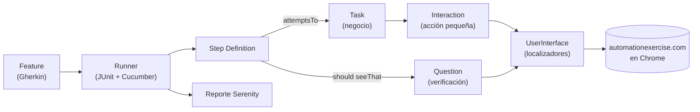

# Automatización E2E de Automation Exercise con Screenplay y Serenity BDD

**Taller de automatización — Calidad de Software 2026-2**
Universidad de Antioquia

| | |
|---|---|
| **Curso** | Calidad de Software |
| **Docente** | Robinson Coronado García |
| **Integrantes** | Carlos Andrey Henao Rincón — andrey.henao@udea.edu.co<br>Manuel Felipe Álvarez Rúa — manuel.alvarez2@udea.edu.co<br>Cristian Echeverry González — cristian.echeverry1@udea.edu.co |
| **Punto del taller** | 5 — https://automationexercise.com/ |
| **Reto** | Realizar una E2E que se registre, seleccione el producto y pueda pagar, validando hasta que la orden de compra sea confirmada |

---

## Tabla de contenido

1. [Descripción del proyecto](#1-descripción-del-proyecto)
2. [Tecnologías y versiones](#2-tecnologías-y-versiones)
3. [Instalación desde cero (Windows)](#3-instalación-desde-cero-windows)
4. [Obtener el proyecto y abrirlo en IntelliJ](#4-obtener-el-proyecto-y-abrirlo-en-intellij)
5. [Estructura del proyecto](#5-estructura-del-proyecto)
6. [Arquitectura Screenplay explicada](#6-arquitectura-screenplay-explicada)
7. [Historias de usuario y escenarios (inglés / español)](#7-historias-de-usuario-y-escenarios-inglés--español)
8. [Cómo ejecutar las pruebas](#8-cómo-ejecutar-las-pruebas)
9. [Reporte de Serenity BDD](#9-reporte-de-serenity-bdd)
10. [Datos de prueba y limpieza de cuentas](#10-datos-de-prueba-y-limpieza-de-cuentas)
11. [Solución de problemas](#11-solución-de-problemas)
12. [Cómo se cumple la rúbrica](#12-cómo-se-cumple-la-rúbrica)
13. [Análisis INVEST y FIRST](#13-análisis-invest-y-first)
14. [Guion para la exposición](#14-guion-para-la-exposición)
15. [Limitaciones conocidas](#15-limitaciones-conocidas)
16. [Glosario para principiantes](#16-glosario-para-principiantes)
17. [Anexo A: cómo se creó el proyecto desde cero](#17-anexo-a-cómo-se-creó-el-proyecto-desde-cero)
18. [Anexo B: subir el proyecto a GitHub](#18-anexo-b-subir-el-proyecto-a-github)

---

## 1. Descripción del proyecto

Este proyecto automatiza pruebas **de extremo a extremo (E2E)** sobre la tienda de práctica
[Automation Exercise](https://automationexercise.com/). Un "actor" (un usuario simulado) abre Chrome
y hace lo mismo que haría una persona:

1. Entra a la tienda.
2. Se **registra** con un correo nuevo.
3. **Agrega productos** al carrito, revisa su precio y cantidad, y también los quita.
4. Hace el **checkout**, **paga** con una tarjeta de prueba y **valida que la orden quedó confirmada**.
5. Al terminar, **borra la cuenta** que creó para no dejar basura en el sitio.

El código sigue el patrón **Screenplay** (Actor → Tasks → Interactions → Questions) sobre
**Serenity BDD** y **Cucumber**, y se generó con el scaffold
[ScreenplayArchitecture](https://github.com/jumosqu12/ScreenplayArchitecture), como pide el taller.

**Resultado actual:** 3 features, 9 escenarios, todos en verde, con reporte HTML de Serenity.

| Feature | Escenarios | Qué valida |
|---|---|---|
| `Register_user.feature` | 4 | Llegar a la tienda, registro exitoso (2 usuarios) y registro con correo repetido |
| `Cart.feature` | 4 | Agregar 3 productos distintos (precio y cantidad) y quitar un producto |
| `Purchase.feature` | 1 | Compra completa hasta "Order Placed!" |

---

## 2. Tecnologías y versiones

| Herramienta | Versión | Para qué sirve |
|---|---|---|
| Java (JDK) | 17 (Eclipse Temurin) | Lenguaje del proyecto |
| Gradle | 8.14.6 (incluido como *wrapper*) | Compila, descarga librerías y ejecuta las pruebas |
| IntelliJ IDEA | Versión gratuita (Community) | Editor (IDE) |
| Google Chrome | Última versión | Navegador que controla la automatización |
| Serenity BDD | 4.1.0 (plugin de reportes 4.1.3) | Patrón Screenplay, control del navegador y reportes |
| Cucumber | Incluido en Serenity 4.1.0 | Ejecuta los escenarios escritos en Gherkin |
| JUnit | 4.13.2 | Motor que lanza los *runners* |
| Lombok | 1.18.22 | Genera *getters* y *builders* de los modelos |
| Plugin ScreenplayArchitecture | 2.0.1 | Scaffold que generó la estructura del proyecto |
| Git | Última versión | Clonar y subir el proyecto a GitHub |

> **No necesitas instalar Gradle.** El proyecto trae `gradlew` / `gradlew.bat` (el *Gradle Wrapper*),
> que descarga solo la versión correcta la primera vez. La instalación global de Gradle se explica
> como **opcional** en el paso 3.4.

---

## 3. Instalación desde cero (Windows)

Sigue los pasos en orden. Al final de cada uno hay una **verificación**: no avances si falla.

### 3.1 Java 17 (JDK)

1. Entra a https://adoptium.net/temurin/releases/?version=17
2. Elige: **Operating System:** Windows · **Architecture:** x64 · **Package Type:** JDK · **Version:** 17.
3. Descarga el instalador **`.msi`**.
4. Ejecútalo. En la pantalla **"Custom Setup"** activa estas dos opciones (clic en el ícono y elige
   *"Will be installed on local hard drive"*):
   - **Add to PATH**
   - **Set JAVA_HOME variable**
5. Termina la instalación y **cierra y vuelve a abrir** cualquier terminal que tengas abierta.

**Verificación** (abre *PowerShell* y escribe):

```powershell
java -version
```

Debe mostrar algo como `openjdk version "17.0.x"`. Y luego:

```powershell
echo $env:JAVA_HOME
```

Debe mostrar una ruta como `C:\Program Files\Eclipse Adoptium\jdk-17...`.

<details>
<summary>Si <code>JAVA_HOME</code> sale vacío: configurarlo a mano</summary>

1. Tecla Windows → escribe **"variables de entorno"** → *Editar las variables de entorno del sistema*.
2. Botón **Variables de entorno…**
3. En *Variables del sistema* → **Nueva…**
   - Nombre: `JAVA_HOME`
   - Valor: la carpeta del JDK, por ejemplo `C:\Program Files\Eclipse Adoptium\jdk-17.0.21.9-hotspot`
4. Selecciona la variable **Path** → **Editar** → **Nuevo** → escribe `%JAVA_HOME%\bin`.
5. Acepta todo y abre una terminal nueva.
</details>

### 3.2 Google Chrome

1. Descarga e instala desde https://www.google.com/chrome/
2. No hay que descargar *ChromeDriver*: Serenity lo descarga solo (`autodownload = true` en `serenity.conf`).

### 3.3 IntelliJ IDEA

1. Entra a https://www.jetbrains.com/idea/download/ y descarga la versión para **Windows**.
   La versión **gratuita** es suficiente (si la página ofrece "Community Edition", elige esa).
2. Ejecuta el instalador. Opciones recomendadas: *Create Desktop Shortcut*, *Add "Open Folder as Project"*
   y asociar archivos `.java`.
3. Abre IntelliJ → **Settings** (Ctrl+Alt+S) → **Plugins** → pestaña *Marketplace*, e instala:
   - **Gherkin** (colorea los `.feature`)
   - **Cucumber for Java** (permite navegar del `.feature` al código del paso)
   - **Lombok** (en versiones recientes ya viene incluido)
4. Reinicia IntelliJ.

### 3.4 Gradle 8.14 (opcional)

El proyecto **no lo necesita**, porque usa el *wrapper*. Instálalo solo si quieres escribir `gradle`
(sin `.\gradlew`) en cualquier carpeta.

1. Descarga https://services.gradle.org/distributions/gradle-8.14.6-bin.zip
   (lista de versiones: https://gradle.org/releases/).
2. Descomprímelo en `C:\Gradle\gradle-8.14.6`.
3. Agrega `C:\Gradle\gradle-8.14.6\bin` a la variable **Path** (igual que en el desplegable del paso 3.1).
4. Abre una terminal nueva y verifica:

```powershell
gradle -v
```

### 3.5 Git

1. Descarga e instala desde https://git-scm.com/download/win (las opciones por defecto están bien).
2. Verifica:

```powershell
git --version
```

3. Configura tu nombre y correo (solo la primera vez):

```powershell
git config --global user.name "Tu Nombre"
```

```powershell
git config --global user.email "tu.correo@udea.edu.co"
```

---

## 4. Obtener el proyecto y abrirlo en IntelliJ

### 4.1 Clonar el repositorio

En PowerShell, ubícate en la carpeta donde guardas tus proyectos (por ejemplo `IdeaProjects`) y clona
(reemplaza la URL por la del repositorio en GitHub):

```powershell
cd $HOME\IdeaProjects
```

```powershell
git clone https://github.com/CahrCod/Taller_Calidad.git
```

### 4.2 Abrir en IntelliJ

1. IntelliJ → **File → Open…** → selecciona la carpeta `Taller_Calidad` (la que contiene `build.gradle`).
2. Si pregunta *"Trust project?"* → **Trust Project**.
3. IntelliJ detecta Gradle y empieza a descargar las dependencias (barra de progreso abajo a la derecha).
   **La primera vez tarda varios minutos.**

### 4.3 Configurar el JDK y Gradle en IntelliJ

1. **File → Project Structure** (Ctrl+Alt+Shift+S) → **Project** → *SDK*: elige **17** (Temurin).
   Si no aparece: *Add SDK → JDK…* y selecciona la carpeta de Java del paso 3.1.
2. **Settings → Build, Execution, Deployment → Build Tools → Gradle**:
   - *Distribution*: **Wrapper** (usa `gradle-wrapper.properties`).
   - *Gradle JVM*: **Project SDK (17)**.
3. **Settings → Build, Execution, Deployment → Compiler → Annotation Processors** →
   marca **Enable annotation processing** (lo necesita Lombok).
4. **Settings → Editor → File Encodings**:
   - *Global* y *Project Encoding*: **UTF-8**.
   - *Create UTF-8 files*: **with NO BOM** (si un archivo `.java` tiene BOM, no compila; ver [solución de problemas](#11-solución-de-problemas)).
5. En el panel **Gradle** (ícono del elefante, a la derecha) → botón **Reload All Gradle Projects**.

### 4.4 Verificación

En la terminal de IntelliJ (pestaña **Terminal**, abajo):

```powershell
.\gradlew clean compileTestJava
```

Debe terminar con **`BUILD SUCCESSFUL`**.

> En **PowerShell** se escribe `.\gradlew`. En la consola clásica **cmd** se escribe `gradlew` (sin `.\`).

---

## 5. Estructura del proyecto

Todo el código vive en el paquete `co.edu.udea.automationexercise.certificacion.moduloprueba`.
La convención es **una carpeta por módulo** (`register`, `cart`, `purchase`), repetida en features,
runners y step definitions.

```
Taller_Calidad/
├── build.gradle                     ← dependencias, plugins y configuración de las pruebas
├── settings.gradle                  ← nombre del proyecto y repositorios de plugins
├── gradlew / gradlew.bat            ← Gradle Wrapper (no hace falta instalar Gradle)
├── gradle/wrapper/                  ← versión de Gradle que usa el wrapper (8.14.6)
├── serenity.properties              ← codificación del reporte
└── src/
    ├── main/java/.../moduloprueba/
    │   ├── userinterfaces/          ← LOCALIZADORES (Targets) de cada página
    │   │   ├── HomePage                 menú, enlaces, "Logged in as"
    │   │   ├── LoginPage                formularios de login y "New User Signup!"
    │   │   ├── SignupFormPage           formulario de datos de la cuenta, "Account Created!"
    │   │   ├── ProductsPage             botón "Add to cart" por nombre, modal del carrito
    │   │   ├── CartPage                 filas del carrito, precio, cantidad, borrar, checkout
    │   │   ├── CheckoutPage             comentario y "Place Order"
    │   │   ├── PaymentPage              datos de la tarjeta y "Order Placed!"
    │   │   └── DeleteAccountPage        "Account Deleted!"
    │   ├── interactions/            ← ACCIONES PEQUEÑAS y reutilizables ("la menuda")
    │   │   ├── Pause                    pausa visible entre pasos (rúbrica)
    │   │   ├── CloseAds                 quita anuncios que tapan botones
    │   │   ├── EnsureOnPage             abre la página esperada si un anuncio bloqueó la navegación
    │   │   └── WaitUntilGone            espera a que un elemento desaparezca del DOM
    │   ├── tasks/                   ← ACCIONES DE NEGOCIO
    │   │   ├── OpenTheStore             abrir la tienda
    │   │   ├── StartSignup              nombre + correo + "Signup"
    │   │   ├── FillAccountForm          llenar el formulario de la cuenta
    │   │   ├── RegisterNewUser          registro completo (StartSignup + FillAccountForm)
    │   │   ├── ConfirmAccountCreated    "Continue" y quedar logueado
    │   │   ├── LogIn / LogOut           iniciar y cerrar sesión
    │   │   ├── AddProductToCart         agregar un producto por su nombre
    │   │   ├── GoToCart                 abrir el carrito
    │   │   ├── RemoveProductFromCart    quitar un producto
    │   │   ├── CheckoutOrder            checkout + comentario + "Place Order"
    │   │   ├── PayOrder                 pagar con tarjeta y esperar la confirmación
    │   │   └── DeleteAccount            borrar la cuenta de prueba
    │   ├── questions/               ← PREGUNTAS que verifican resultados
    │   │   ├── IsVisible, CurrentUrl, PageTitle, LoggedInUser
    │   │   ├── AccountCreatedMessage, OrderPlacedMessage
    │   │   └── ProductInCart, CartProductPrice, CartProductQuantity
    │   ├── models/                  ← DATOS de prueba
    │   │   ├── UserData                 usuario con correo único
    │   │   └── CardData                 tarjeta de prueba
    │   └── utils/Util               ← genera correos únicos
    └── test/
        ├── java/.../moduloprueba/
        │   ├── runners/             ← un RUNNER por feature
        │   │   ├── register/Register_user_Runner
        │   │   ├── cart/Cart_Runner
        │   │   └── purchase/Purchase_Runner
        │   └── stepdefinitions/     ← traducen cada línea Gherkin a código
        │       ├── hooks/Hooks                       crea el actor, borra la cuenta y cierra el navegador
        │       ├── common/Customer_StepDefinition    pasos compartidos por Cart y Purchase
        │       ├── register/Register_user_StepDefinition
        │       ├── cart/Cart_StepDefinition
        │       └── purchase/Purchase_StepDefinition
        └── resources/
            ├── serenity.conf        ← navegador, tiempos de espera, capturas y URL de la tienda
            └── features/            ← HISTORIAS DE USUARIO en Gherkin
                ├── register/Register_user.feature
                ├── cart/Cart.feature
                └── purchase/Purchase.feature
```

Las carpetas `exceptions/` e `integrations/` y las clases `Model`, `UserInterface`, `Exception` e
`Integration` son *placeholders* que dejó el scaffold; no se usan.

---

## 6. Arquitectura Screenplay explicada

### 6.1 La idea en una frase

> Un **Actor** intenta realizar **Tasks** (qué quiere lograr, en lenguaje de negocio), que se
> componen de **Interactions** (cómo lo hace, clic por clic) sobre **UserInterfaces** (dónde están
> los elementos), y al final hace **Questions** para comprobar el resultado.

### 6.2 Flujo de una prueba



### 6.3 Ejemplo real: agregar un producto al carrito

**1. Feature** (`Cart.feature`): qué se espera, en lenguaje natural.

```gherkin
When I add the product "<product>" to the cart
Then the product "<product>" is in the shopping cart
```

**2. Step Definition** (`Cart_StepDefinition`): conecta la frase con el actor.

```java
@When("I add the product {string} to the cart")
public void iAddTheProductToTheCart(String product) {
    customer().attemptsTo(AddProductToCart.named(product));
}
```

**3. Task** (`AddProductToCart`): la intención de negocio, compuesta de pasos.

```java
actor.attemptsTo(
        Open.url(ProductsPage.URL),
        EnsureOnPage.withUrl(ProductsPage.URL),
        WaitUntil.the(ProductsPage.ADD_TO_CART.of(product), isVisible()).forNoMoreThan(20).seconds(),
        CloseAds.ifPresent(),
        Pause.forAMoment(),
        JavaScriptClick.on(ProductsPage.ADD_TO_CART.of(product)),
        WaitUntil.the(ProductsPage.CONTINUE_SHOPPING, isVisible()).forNoMoreThan(10).seconds(),
        Pause.forAMoment(),
        Click.on(ProductsPage.CONTINUE_SHOPPING));
```

**4. UserInterface** (`ProductsPage`): dónde está el botón.

```java
public static final Target ADD_TO_CART = Target.the("add to cart of {0}")
        .locatedBy("(//div[@class='productinfo text-center'][contains(normalize-space(p),'{0}')]"
                + "/a[contains(@class,'add-to-cart')])[1]");
```

**5. Question** (`ProductInCart`): la verificación del `Then`.

```java
customer().should(seeThat(ProductInCart.named(product), is(true)));
```

### 6.4 Qué va en cada capa (regla práctica)

| Capa | Pregunta que responde | Ejemplo | No debe contener |
|---|---|---|---|
| Feature | ¿Qué quiere el usuario? | `When I add the product "Blue Top" to the cart` | Detalles técnicos (XPath, clics) |
| Step Definition | ¿Qué Task o Question corresponde a esta frase? | `attemptsTo(AddProductToCart.named(product))` | Lógica de Selenium |
| Task | ¿Qué hace el actor en términos de negocio? | `RegisterNewUser`, `PayOrder` | Localizadores escritos a mano |
| Interaction | ¿Cómo se ejecuta una acción técnica pequeña? | `Pause`, `CloseAds`, `WaitUntilGone` | Reglas de negocio |
| UserInterface | ¿Dónde está el elemento? | `PaymentPage.CARD_NUMBER` | Acciones |
| Question | ¿Qué estado tiene la aplicación? | `OrderPlacedMessage.text()` | Clics o cambios de estado |
| Model | ¿Con qué datos se prueba? | `UserData.withName("Ana")` | Acceso al navegador |

---

## 7. Historias de usuario y escenarios (inglés / español)

Los `.feature` están en **inglés** (así está en el código). La columna de la derecha es la traducción.
Las palabras `Given / When / Then / And` equivalen a **Dado / Cuando / Entonces / Y**.

### 7.1 Registro de usuario — `features/register/Register_user.feature`

| Inglés (código) | Español (traducción) |
|---|---|
| **Feature:** As a new user I want to register on the website So that I can buy products and track my orders | **Característica:** Como usuario nuevo quiero registrarme en el sitio web para poder comprar productos y hacer seguimiento a mis pedidos |
| **Scenario:** Arriving at the store | **Escenario:** Llegar a la tienda |
| Given I am a new user | Dado que soy un usuario nuevo |
| When I open the Automation Exercise store | Cuando abro la tienda Automation Exercise |
| Then I see the home page | Entonces veo la página de inicio |
| And I see the option to sign up | Y veo la opción para registrarme |
| And I am not logged in | Y no tengo una sesión iniciada |
| **Scenario Outline:** Successful registration | **Esquema del escenario:** Registro exitoso |
| Given I am a new user on the store home page | Dado que soy un usuario nuevo en la página de inicio de la tienda |
| When I register as "&lt;name&gt;" using a new email address | Cuando me registro como "&lt;name&gt;" usando un correo nuevo |
| Then I see the successful registration message | Entonces veo el mensaje de registro exitoso |
| And I am logged in as "&lt;name&gt;" | Y tengo la sesión iniciada como "&lt;name&gt;" |
| **Examples:** name = `Ana`, `Luis` | **Ejemplos:** nombre = `Ana`, `Luis` |
| **Scenario:** Registration with an email address that already exists | **Escenario:** Registro con un correo que ya existe |
| Given a user is already registered in the store | Dado que un usuario ya está registrado en la tienda |
| When I try to sign up again with that same email address | Cuando intento registrarme de nuevo con ese mismo correo |
| Then I see the message that the email address already exists | Entonces veo el mensaje de que el correo ya existe |
| And I remain on the signup page | Y permanezco en la página de registro |

### 7.2 Carrito de compras — `features/cart/Cart.feature`

| Inglés (código) | Español (traducción) |
|---|---|
| **Feature:** As a registered customer I want to manage the products in my shopping cart So that I only pay for what I really need | **Característica:** Como cliente registrado quiero gestionar los productos de mi carrito de compras para pagar solo lo que realmente necesito |
| **Background:** Given I am a customer registered and logged in to the store | **Antecedentes:** Dado que soy un cliente registrado y con sesión iniciada en la tienda |
| **Scenario Outline:** Adding a product to the cart | **Esquema del escenario:** Agregar un producto al carrito |
| When I add the product "&lt;product&gt;" to the cart | Cuando agrego el producto "&lt;product&gt;" al carrito |
| Then the product "&lt;product&gt;" is in the shopping cart | Entonces el producto "&lt;product&gt;" está en el carrito de compras |
| And the product "&lt;product&gt;" has the price "&lt;price&gt;" and the quantity "1" | Y el producto "&lt;product&gt;" tiene el precio "&lt;price&gt;" y la cantidad "1" |
| **Examples:** Blue Top / Rs. 500 · Men Tshirt / Rs. 400 · Stylish Dress / Rs. 1500 | **Ejemplos:** Blue Top / Rs. 500 · Men Tshirt / Rs. 400 · Stylish Dress / Rs. 1500 |
| **Scenario:** Removing a product from the cart | **Escenario:** Quitar un producto del carrito |
| Given I have a product in the shopping cart | Dado que tengo un producto en el carrito de compras |
| When I remove that product from the cart | Cuando quito ese producto del carrito |
| Then the cart no longer contains that product | Entonces el carrito ya no contiene ese producto |

### 7.3 Compra — `features/purchase/Purchase.feature`

| Inglés (código) | Español (traducción) |
|---|---|
| **Feature:** As a registered customer I want to pay for the products in my cart So that my order is confirmed and shipped to my address | **Característica:** Como cliente registrado quiero pagar los productos de mi carrito para que mi pedido quede confirmado y se envíe a mi dirección |
| **Background:** Given I am a customer registered and logged in to the store | **Antecedentes:** Dado que soy un cliente registrado y con sesión iniciada en la tienda |
| **Scenario:** Confirming the purchase order | **Escenario:** Confirmar la orden de compra |
| Given I have a product in the shopping cart | Dado que tengo un producto en el carrito de compras |
| When I complete the purchase details and confirm the order | Cuando completo los datos de la compra y confirmo la orden |
| Then I see the message that the order has been placed | Entonces veo el mensaje de que la orden fue realizada |

### 7.4 Qué pasa por dentro en la compra (E2E del punto 5)

| # | Paso visible en el navegador | Task que lo hace |
|---|---|---|
| 1 | Abre la tienda | `OpenTheStore` |
| 2 | "Signup / Login" → nombre + correo único → "Signup" | `StartSignup` |
| 3 | Llena contraseña, nombre, dirección, país, ciudad, teléfono → "Create Account" | `FillAccountForm` |
| 4 | Ve "Account Created!" → "Continue" → queda logueado | `RegisterNewUser` + `ConfirmAccountCreated` |
| 5 | Productos → "Add to cart" de Blue Top → "Continue Shopping" | `AddProductToCart` |
| 6 | Carrito → "Proceed To Checkout" → comentario → "Place Order" | `CheckoutOrder` |
| 7 | Tarjeta (nombre, número, CVC, mes, año) → "Pay and Confirm Order" | `PayOrder` |
| 8 | **Verifica "Order Placed!"** | `OrderPlacedMessage` (Question) |
| 9 | Borra la cuenta → "Account Deleted!" | `DeleteAccount` (en el `@After`) |

---

## 8. Cómo ejecutar las pruebas

Todos los comandos se ejecutan en la **raíz del proyecto** (donde está `build.gradle`), desde la terminal
de IntelliJ o PowerShell.

### 8.1 Desde IntelliJ (recomendado para ver el navegador)

1. Abre el runner, por ejemplo `src/test/java/.../runners/cart/Cart_Runner.java`.
2. Clic derecho sobre la clase → **Run 'Cart_Runner'** (o el triángulo verde junto a `public class`).
3. Abajo, en el panel *Run*: ✅ verde = pasó, ❌ rojo = falló (clic para ver el paso y el error).

> Ejecuta siempre desde el **runner**, no con el triángulo del `.feature`: desde el feature IntelliJ usa
> Cucumber sin Serenity y el actor no se inicializa.

### 8.2 Comandos de terminal

**Compilar** (sin ejecutar pruebas):

```powershell
.\gradlew clean compileTestJava
```

**Ejecutar todas las pruebas** (los 3 features) y generar el reporte:

```powershell
.\gradlew clean test
```

**Ejecutar un solo feature:**

```powershell
.\gradlew clean test --tests "*Register_user_Runner"
```

```powershell
.\gradlew clean test --tests "*Cart_Runner"
```

```powershell
.\gradlew clean test --tests "*Purchase_Runner"
```

**Ejecutar sin las pausas** (más rápido, para cuando no se está exponiendo). En PowerShell el
argumento `-D...` va **entre comillas**:

```powershell
.\gradlew clean test "-Dpause.millis=0"
```

**Regenerar solo el reporte** (sin volver a correr las pruebas):

```powershell
.\gradlew aggregate
```

### 8.3 Ejecutar un solo escenario (para depurar)

1. En el `.feature`, escribe `@wip` en la línea de arriba del escenario:

   ```gherkin
   @wip
   Scenario: Removing a product from the cart
   ```

2. En el runner de ese feature, agrega temporalmente `tags = "@wip"` dentro de `@CucumberOptions`:

   ```java
   @CucumberOptions(
           features = "src/test/resources/features/cart/Cart.feature",
           glue = {...},
           tags = "@wip",
           snippets = CucumberOptions.SnippetType.CAMELCASE
   )
   ```

3. Ejecuta el runner. Cuando termines, **quita** el `tags` y el `@wip`.

### 8.4 Qué esperar

- Chrome se abre **una vez por escenario** (cada escenario es independiente) y se cierra al final.
- Entre acciones hay una **pausa de 1,5 s** para poder seguir la prueba con la vista (lo pide la rúbrica).
- La suite completa tarda **varios minutos**: cada escenario de carrito y compra registra una cuenta
  nueva y al final la borra.
- Al terminar debe aparecer `BUILD SUCCESSFUL` y, más arriba, `> Task :aggregate` con la ruta del reporte.
- Si alguna prueba falla, aparece `BUILD FAILED` y una línea `... FAILED` por cada escenario fallido.
  El reporte de Serenity **se genera igual**.

### 8.5 Configuración relevante (`serenity.conf` y `build.gradle`)

| Configuración | Valor | Por qué |
|---|---|---|
| `serenity.take.screenshots` | `FOR_EACH_ACTION` | Una captura por acción en el reporte |
| `serenity.use.unique.browser` | `false` | Un navegador nuevo por escenario (independencia) |
| `webdriver.wait.for.timeout` | `20000` | El sitio es lento: se espera hasta 20 s por elemento |
| `chrome.switches` → `--host-resolver-rules` | bloquea `*.googlesyndication.com` | Quita los anuncios de Google que tapaban botones y alteraban textos |
| `pages.automationUrl` | `https://automationexercise.com/` | URL base de la tienda |
| `pause.millis` (en `build.gradle`) | `1500` por defecto | Duración de la pausa entre pasos |
| `finalizedBy 'aggregate'` (en `build.gradle`) | — | Genera el reporte al terminar las pruebas |
| `clean { delete 'target' }` (en `build.gradle`) | — | `clean` borra también el reporte anterior, para que se regenere completo con sus estilos (ver 9.3) |

---

## 9. Reporte de Serenity BDD

### 9.1 Dónde está

Después de `.\gradlew clean test`, abre en Chrome:

```
target/site/serenity/index.html
```

En IntelliJ: clic derecho sobre `index.html` → **Open In → Browser → Chrome**.

### 9.2 Cómo leerlo

| Pestaña / sección | Qué muestra |
|---|---|
| **Overview** | Resumen: total de escenarios, pasados y fallidos, con gráficos |
| **Requirements / Features** | Cada `.feature` como requisito, con su estado |
| **Test Results** | Lista de todos los escenarios; clic en uno para ver el detalle |
| **Detalle de un escenario** | Los pasos Gherkin, las Tasks e Interactions que ejecutó el actor, el tiempo de cada una y **una captura de pantalla por acción** |

Si un escenario falla, la captura del paso fallido muestra exactamente qué tenía la pantalla en ese
momento. Así diagnosticamos varios problemas de este proyecto (ver [sección 11](#11-solución-de-problemas)).

### 9.3 Si el reporte se ve sin estilos (texto plano)

**Síntoma:** `index.html` abre, pero se ve como texto plano: sin logo, sin colores y sin gráficos.

**Causa:** los estilos y scripts del reporte (`bootstrap/`, `css/`, `scripts/`, `chartjs/`…) vienen dentro
de la librería `serenity-report-resources` y Serenity los copia a `target/site/serenity` al generar el
reporte. Cuando los copia, deja un archivo vacío llamado `serenity-resources` como **marca de "recursos
ya copiados"**. Si una copia falla pero la marca queda creada, las ejecuciones siguientes ven la marca,
no vuelven a copiar nada y el reporte sale sin estilos para siempre.

**Corrección aplicada en el proyecto:** en `build.gradle`, la tarea `clean` borra también la carpeta
`target/`. Así, cada `.\gradlew clean test` genera el reporte desde cero, con sus recursos:

```groovy
tasks.named('clean') {
    delete 'target'
}
```

**Si te vuelve a pasar:**

```powershell
.\gradlew clean test
```

O, sin repetir las pruebas, borra solo la marca y regenera el reporte:

```powershell
Remove-Item target\site\serenity\serenity-resources
```

```powershell
.\gradlew aggregate
```

**Cómo saber que quedó bien:** dentro de `target/site/serenity/` deben existir las carpetas `bootstrap/`,
`css/` y `scripts/`, y el reporte debe mostrar el logo de Serenity y la dona de resultados.

---

## 10. Datos de prueba y limpieza de cuentas

| Dato | Valor | Dónde se define |
|---|---|---|
| Correo | `<nombre>.<milisegundos>@test.com` (único en cada ejecución) | `Util.uniqueEmail` |
| Contraseña | `Test1234*` | `UserData.withName` |
| Dirección | Calle 10 # 20-30, Medellín, Antioquia, Canada, 050001 | `UserData.withName` |
| Teléfono | 3001234567 | `UserData.withName` |
| Tarjeta | Ana QA · 4111111111111111 · CVC 123 · 12/2030 | `CardData.valid` |
| Comentario de la orden | "Pedido de prueba automatizada - Taller Calidad de Software" | `Purchase_StepDefinition` |

- **Correos únicos:** el sitio no deja registrar dos veces el mismo correo, así que se generan con la
  hora en milisegundos. Las pruebas se pueden repetir sin cambiar nada.
- **Tarjeta de prueba:** el sitio es de práctica y no procesa pagos reales.
- **Limpieza automática:** `RegisterNewUser` guarda el usuario en la memoria del actor. Al terminar cada
  escenario, el `@After` de `Hooks` ejecuta `DeleteAccount` (inicia sesión si hace falta, abre
  `/delete_account` y espera "Account Deleted!") y luego cierra el navegador.
- Si la limpieza falla, **no** se marca el escenario como fallido: solo aparece en consola el aviso
  `No se pudo eliminar la cuenta de prueba`.

---

## 11. Solución de problemas

Errores reales que aparecieron durante el desarrollo y cómo se resolvieron.

| Síntoma | Causa | Solución |
|---|---|---|
| `gradle : El término 'gradle' no se reconoce...` | Gradle no está instalado globalmente | Usa el wrapper: `.\gradlew ...` (no hace falta instalar Gradle) |
| `error: illegal character: '\ufeff'` | El archivo se guardó en UTF-8 **con BOM** | Guardar sin BOM. En IntelliJ: *Settings → Editor → File Encodings → Create UTF-8 files: with NO BOM*; o en la barra inferior, clic en "UTF-8 with BOM" → *Remove BOM* |
| `waiting for By.xpath: a[href='/login']` (o `a.check_out`) | Serenity confundió un selector **CSS** con XPath | Declarar los CSS con `.located(By.cssSelector("..."))`. Regla del proyecto: **CSS siempre con `By.cssSelector`**, XPath con `locatedBy("//...")` |
| `no matching element found ... Men Tshirt` | Los anuncios de Google insertaban enlaces dentro del nombre del producto | Bloquear anuncios con `--host-resolver-rules` y usar `contains(normalize-space(...))` en los XPath |
| `waiting for ... a[href='/logout'] to be present` tras "Continue" | Un anuncio de pantalla completa (*vignette*) bloqueaba la navegación | `ConfirmAccountCreated` abre el inicio directamente; `LogOut` abre `/logout`; `EnsureOnPage` reabre la página esperada |
| `StaleElementReferenceException` al borrar del carrito | El sitio elimina la fila del DOM y la espera usaba una referencia vieja | Interaction `WaitUntilGone` y Question `ProductInCart` buscan el elemento de nuevo en cada intento |
| `tried for 5 second(s)` en pasos que a veces pasan | El sitio es lento | `webdriver.wait.for.timeout = 20000` y esperas explícitas (`WaitUntil`) |
| IntelliJ marca en rojo `UserData.builder()` o `getName()` | Lombok sin *annotation processing* | *Settings → Compiler → Annotation Processors → Enable annotation processing* |
| Pasos "undefined" en IntelliJ aunque el código existe | Caché del plugin de Cucumber | Recargar Gradle o *File → Invalidate Caches → Invalidate and Restart* |
| `PendingException: TODO: implement me` | Un paso todavía no tiene código | Implementar el método del step definition |
| `Unable to find CDP implementation matching 157` | Chrome es más nuevo que Selenium 4.16.1 | Es solo un **aviso**; no afecta las pruebas |
| `Deprecated Gradle features were used...` | Aviso de Gradle sobre funciones obsoletas | Es solo un **aviso**; se puede ignorar |
| `SessionNotCreatedException` | No se pudo descargar ChromeDriver o Chrome está desactualizado | Revisar internet y actualizar Chrome |
| `I remain on the signup page` falla por la URL | El sitio cambió la ruta tras el error de correo | Ajustar `"/signup"` por la URL real en `Register_user_StepDefinition` |
| El reporte `index.html` se ve como texto plano, sin estilos ni gráficos | La copia de los recursos del reporte falló y quedó la marca vacía `serenity-resources`, que impide volver a copiarlos | `.\gradlew clean test` (ahora `clean` borra `target/`). Detalle en la [sección 9.3](#93-si-el-reporte-se-ve-sin-estilos-texto-plano) |
| `-Dpause.millis=0` no tiene efecto o da error en PowerShell | PowerShell separa el argumento en el punto | Escribirlo entre comillas: `"-Dpause.millis=0"` |

---

## 12. Cómo se cumple la rúbrica

| Criterio | Puntos | Cómo lo cumple el proyecto |
|---|---|---|
| **Cobertura y profundidad funcional** | 15 | Ruta feliz completa (registro → carrito → pago → orden confirmada). Camino excepcional: correo ya registrado. Caminos alternos: quitar productos, 3 productos con precios distintos (Scenario Outline), validación de precio, cantidad, sesión iniciada y título. Escenarios independientes con datos únicos |
| **Reportes de la prueba automatizada** | 10 | Plugin de Serenity 4.1.3 con `aggregate` automático; reporte HTML en `target/site/serenity/index.html` con captura por acción |
| **Calidad del código y buenas prácticas** | 10 | Screenplay por capas (UserInterfaces = PageObjects), Tasks en lenguaje de negocio, Interactions reutilizables, Questions separadas, modelos con Lombok, paquetes por módulo, pasos compartidos en `common`, limpieza automática de datos, comentarios en las clases clave |
| **Creatividad e innovación** | 10 | Bloqueo de anuncios por DNS en Chrome, `EnsureOnPage` contra anuncios de pantalla completa, `WaitUntilGone` contra elementos que desaparecen, borrado automático de cuentas, pausa configurable, análisis INVEST/FIRST |
| **Socialización** | 55 | Pausa de 1,5 s entre pasos (`Pause`) para observar la prueba; guion de exposición en la [sección 14](#14-guion-para-la-exposición); reporte con evidencias |

**Indicaciones del taller (sección 6 del enunciado):**

| Indicación | Dónde |
|---|---|
| Generar el arquetipo con el scaffold | `build.gradle` (plugin 2.0.1) y [Anexo A](#17-anexo-a-cómo-se-creó-el-proyecto-desde-cero) |
| Escenarios en el archivo Feature | `src/test/resources/features/` |
| Actor principal en el StepDefinition | `Hooks` (`OnStage.theActorCalled("user")`) y `OnStage.theActorInTheSpotlight()` en cada step |
| Batería de pruebas en Gherkin | 3 features, 9 escenarios |
| Tasks en términos de negocio según criterios de aceptación | `tasks/` (los features se escribieron primero) |
| Interactions ("la menuda") | `interactions/` |
| Verificar resultados con Questions | `questions/` |
| Generar el reporte de automatización | Serenity `aggregate` |

---

## 13. Análisis INVEST y FIRST

### 13.1 INVEST (calidad de las historias de usuario)

| Criterio | Register_user | Cart | Purchase |
|---|---|---|---|
| **I**ndependent | ✅ | ✅* | ✅* |
| **N**egotiable | ✅ | ✅ | ✅ |
| **V**aluable | ✅ | ✅ | ✅ |
| **E**stimable | ✅ | ✅ | ✅ |
| **S**mall | ✅ | ✅ | ✅ |
| **T**estable | ✅ | ✅ | ✅ |

\* El sitio exige una cuenta para comprar, así que Cart y Purchase necesitan un cliente registrado. Esa
dependencia es una **regla del negocio** y está declarada como precondición en el `Background`.

Decisiones tomadas para cumplir INVEST:
- El "So that" de cada historia expresa el **beneficio real** para el usuario.
- La historia original de compra se **dividió** en *Cart* (gestionar el carrito) y *Purchase* (pagar),
  para que cada una sea pequeña y tenga un solo objetivo.

### 13.2 FIRST (calidad de las pruebas)

| Principio | Estado | Justificación |
|---|---|---|
| **F**ast | ⚠️ Parcial | Son pruebas E2E por navegador contra un sitio externo: son lentas por naturaleza. La pausa de 1,5 s es intencional (rúbrica) y se puede desactivar con `"-Dpause.millis=0"` |
| **I**ndependent | ✅ | Navegador nuevo por escenario, datos propios (correo único), ningún escenario depende del orden de ejecución |
| **R**epeatable | ✅ | Correos únicos, cuentas borradas al terminar, anuncios bloqueados y esperas explícitas. Depende de que el sitio externo esté disponible |
| **S**elf-validating | ✅ | Cada escenario termina con `Then` que usan Questions y `seeThat`: el resultado es pasa/falla automático, con evidencia en el reporte |
| **T**imely | ✅ | Se siguió BDD: primero los criterios de aceptación en Gherkin, luego los steps pendientes y después la implementación |

---

## 14. Guion para la exposición

Duración sugerida: 15 a 20 minutos. La socialización vale **55 puntos**.

| # | Tema | Qué mostrar | Tiempo |
|---|---|---|---|
| 1 | Contexto | Punto 5 del taller, el sitio y el reto E2E | 1 min |
| 2 | Historias de usuario | Los 3 `.feature` y la tabla inglés/español (sección 7); por qué se dividió la compra (INVEST) | 3 min |
| 3 | Arquitectura | Diagrama de la sección 6.2 y el recorrido de "agregar al carrito" por las capas (6.3) | 3 min |
| 4 | **Demo en vivo** | `Purchase_Runner` desde IntelliJ con la pausa activa: registro → carrito → pago → "Order Placed!" → "Account Deleted!" | 3-4 min |
| 5 | Caminos alternos y de error | `Register_user_Runner` (correo repetido) o el reporte de `Cart` (precios y cantidad) | 2 min |
| 6 | Reporte Serenity | Overview, un escenario con sus capturas paso a paso | 2 min |
| 7 | Problemas y soluciones | 3 o 4 filas de la sección 11: anuncios, CSS leído como XPath, elemento que desaparece | 3 min |
| 8 | Cierre | Rúbrica (sección 12), FIRST y limitaciones | 1 min |

**Recomendaciones:**
- Ejecuten la suite completa **antes** de la exposición y tengan el reporte abierto, por si el sitio está
  lento durante la demo.
- Para la demo en vivo usen un solo runner (`Purchase_Runner` es el más representativo).
- Cada integrante debería poder explicar al menos una Task, una Interaction y una Question.

**Preguntas probables y respuesta corta:**

| Pregunta | Respuesta |
|---|---|
| ¿Qué diferencia hay entre una Task y una Interaction? | La Task expresa una intención de negocio (`PayOrder`); la Interaction es una acción técnica pequeña y reutilizable (`Pause`, `CloseAds`) |
| ¿Por qué no usan `Thread.sleep` para esperar? | Solo se usa en `Pause`, que es intencional para observar la prueba. Las esperas reales son explícitas (`WaitUntil`, `WaitUntilGone`): esperan lo necesario y no más |
| ¿Cómo garantizan que las pruebas se puedan repetir? | Correo único por ejecución, borrado de la cuenta al final y un navegador nuevo por escenario |
| ¿Qué pasa si el sitio cambia? | Solo hay que actualizar los localizadores en `userinterfaces/`; Tasks y features no cambian |

---

## 15. Limitaciones conocidas

- **Dependencia de un sitio externo:** si automationexercise.com está caído, lento o cambia su HTML,
  las pruebas pueden fallar sin que haya un error en el código.
- **Velocidad:** las pruebas E2E por navegador son lentas; la pausa de 1,5 s las hace más lentas a
  propósito.
- **Anuncios:** se bloquean por DNS en el Chrome de las pruebas; si Google cambia los dominios de sus
  anuncios, podría hacer falta actualizar la regla de `chrome.switches`.
- **Solo Chrome:** la configuración está pensada para Chrome en Windows.
- **Datos en el sitio:** si una ejecución se interrumpe (por ejemplo, se cierra el navegador a mano),
  la cuenta de ese escenario puede quedar sin borrar.

---

## 16. Glosario para principiantes

| Término | Significado |
|---|---|
| **E2E (End to End)** | Prueba que recorre un flujo completo como lo haría un usuario real |
| **BDD** | *Behaviour Driven Development*: describir primero el comportamiento esperado en lenguaje natural y luego automatizarlo |
| **Gherkin** | Lenguaje de los `.feature`: `Feature`, `Scenario`, `Given`, `When`, `Then`, `And` |
| **Scenario Outline / Examples** | Un escenario que se repite con varios datos (una vez por fila de `Examples`) |
| **Background** | Pasos que se ejecutan antes de cada escenario del feature |
| **Cucumber** | Herramienta que lee los `.feature` y ejecuta el código de cada paso |
| **Step Definition** | Método Java anotado con `@Given/@When/@Then` que corresponde a una frase Gherkin |
| **Runner** | Clase JUnit que indica qué feature ejecutar y dónde están sus steps |
| **Glue** | Paquetes donde Cucumber busca los step definitions y hooks |
| **Hook** | Código que se ejecuta antes (`@Before`) o después (`@After`) de cada escenario |
| **Serenity BDD** | Framework que integra Cucumber, Selenium y Screenplay, y genera el reporte |
| **Screenplay** | Patrón de diseño centrado en un Actor que realiza Tasks y responde Questions |
| **Actor** | El "usuario" simulado que ejecuta las acciones |
| **Task** | Acción de negocio del actor (ej.: pagar la orden) |
| **Interaction** | Acción técnica pequeña (ej.: hacer una pausa, quitar anuncios) |
| **Question** | Consulta del estado de la aplicación para verificar un resultado |
| **Target / localizador** | Forma de encontrar un elemento en la página (CSS o XPath) |
| **CSS selector** | Localizador como `a.check_out` o `[data-qa='pay-button']` |
| **XPath** | Localizador como `//td[@class='cart_description']/h4` |
| **DOM** | Estructura en memoria de la página web que el navegador muestra |
| **Wrapper (`gradlew`)** | Script que descarga y usa la versión correcta de Gradle sin instalarla |
| **Lombok** | Librería que genera código repetitivo (getters, builders) con anotaciones |
| **BOM** | Carácter invisible al inicio de algunos archivos UTF-8 que rompe la compilación de Java |

---

## 17. Anexo A: cómo se creó el proyecto desde cero

Estos pasos **ya están hechos** en el repositorio. Sirven para entender el origen del proyecto o para
crear uno nuevo con la misma arquitectura.

1. Crear una carpeta vacía y abrirla en IntelliJ.
2. Crear un `build.gradle` con solo el plugin del scaffold:

   ```groovy
   plugins {
       id "io.github.jumosqu12.screenplayarchitecture" version "2.0.1"
   }
   ```

3. Generar el wrapper de Gradle (requiere Gradle instalado globalmente, paso 3.4, o hacerlo desde
   IntelliJ al crear un proyecto Gradle):

   ```powershell
   gradle wrapper --gradle-version 8.14.6
   ```

4. Generar la estructura Screenplay (tipo UX = interfaz web):

   ```powershell
   .\gradlew spa --projectName=Taller_Calidad --groupId=co.edu.udea.automationexercise.certificacion --principalPackage=moduloprueba --type=UX
   ```

   > ⚠️ Este comando **sobrescribe `build.gradle`**. No lo vuelvas a ejecutar en este proyecto.

5. Otros generadores del scaffold:

   | Comando | Qué genera |
   |---|---|
   | `.\gradlew gft --name=Cart --nameSubFolder=cart --examples=true` | `features/cart/Cart.feature` (con Scenario Outline) |
   | `.\gradlew grun --name=Cart_Runner --folderName=cart` | `runners/cart/Cart_Runner.java` |
   | `.\gradlew gtk --name=PayOrder --typeTask=Ux` | `tasks/PayOrder.java` |
   | `.\gradlew gcr --features=cart/Cart,purchase/Purchase --language=EN` | JSON con la ruta crítica |

6. Después del scaffold se hicieron estos ajustes manuales:
   - En los runners, corregir el `glue` (al generado le faltaba `.moduloprueba`) y la ruta del feature.
   - En `serenity.conf`, cambiar la URL de ejemplo por `https://automationexercise.com/`.
   - Borrar los placeholders `Task.java`, `Interaction.java` y `Question.java`, que chocaban con las
     interfaces de Serenity del mismo nombre.
   - Agregar el plugin `net.serenity-bdd.serenity-gradle-plugin` para el reporte.

Documentación del scaffold: https://github.com/jumosqu12/ScreenplayArchitecture

---

## 18. Anexo B: subir el proyecto a GitHub

Solo lo hace **una persona del equipo, una vez**. Los demás clonan el repositorio (paso 4.1).

1. En https://github.com → **New repository** → nombre `Taller_Calidad` → **sin** README ni `.gitignore`
   (ya existen en el proyecto) → **Create repository**.
2. En la terminal, en la raíz del proyecto:

```powershell
git init
```

```powershell
git add .
```

```powershell
git commit -m "Automatización E2E de Automation Exercise con Screenplay y Serenity"
```

```powershell
git branch -M main
```

```powershell
git remote add origin https://github.com/CahrCod/Taller_Calidad.git
```

```powershell
git push -u origin main
```

3. Antes del `git add .`, verifica que exista el archivo `.gitignore` en la raíz: evita subir carpetas
   generadas (`build/`, `target/`, `.gradle/`, `.idea/`). El archivo `gradle/wrapper/gradle-wrapper.jar`
   **sí** debe subirse.

**Trabajo en equipo (día a día):**

```powershell
git pull
```

```powershell
git add .
```

```powershell
git commit -m "Describe el cambio"
```

```powershell
git push
```
